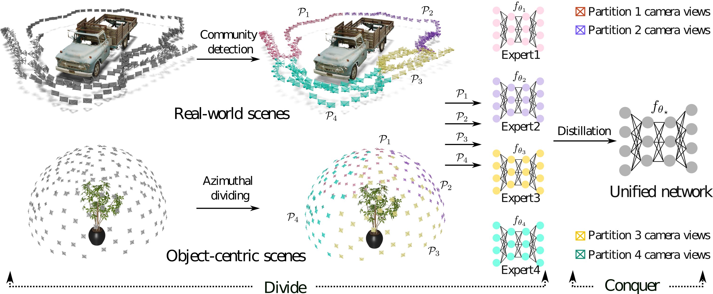

# Divide and Conquer: Rethinking the Training Paradigm of Neural Radiance Fields

[](https://github.com/RongKaiWeskerMA/Divide-and-Conquer/actions/workflows/ci.yml)
[](https://arxiv.org/abs/2401.16144)

Official implementation of [*Divide and Conquer: Rethinking the Training Paradigm of Neural Radiance Fields*](https://arxiv.org/abs/2401.16144). Please check out the paper for details.



Neural radiance fields (NeRFs) have exhibited potential in synthesizing high-fidelity views of 3D scenes but the standard training paradigm of NeRF presupposes an equal importance for each image in the training set. This assumption poses a significant challenge for rendering specific views presenting intricate geometries, thereby resulting in suboptimal performance. In this paper, we take a closer look at the implications of the current training paradigm and redesign this for more superior rendering quality by NeRFs. Dividing input views into multiple groups based on their visual similarities and training individual models on each of these groups enables each model to specialize on specific regions without sacrificing speed or efficiency. Subsequently, the knowledge of these specialized models is aggregated into a single entity via a teacher-student distillation paradigm, enabling spatial efficiency for online rendering. Empirically, we evaluate our novel training framework on two publicly available datasets, namely NeRF synthetic and Tanks&Temples. Our evaluation demonstrates that our DaC training pipeline enhances the rendering quality of a state-of-the-art baseline model while exhibiting convergence to a superior minimum.

## Installation

Requires Python ≥ 3.9 and a CUDA GPU for training at full speed.

```bash
conda create -n dac python=3.10
conda activate dac
pip install -e .
```

Install [tiny-cuda-nn](https://github.com/NVlabs/tiny-cuda-nn) for your CUDA version; it provides the fused MLPs used by the published models:

```bash
pip install git+https://github.com/NVlabs/tiny-cuda-nn/#subdirectory=bindings/torch
```

Without tiny-cuda-nn, `dac` falls back to an equivalent pure-PyTorch implementation (with a warning). The fallback is much slower and its checkpoints are not interchangeable with tiny-cuda-nn ones, so use it for development and testing only. Set `DAC_DISABLE_TCNN=1` to force the fallback.

## Data

Scenes use the Blender `transforms_{split}.json` format:

```
data/nerf_synthetic/lego/            # NeRF-Synthetic, as released
├── transforms_train.json
├── transforms_test.json
├── train/r_0.png ...
└── test/r_0.png ...

data/TanksAndTempleBG/Playground/    # Tanks and Temples, converted to the same format
├── transforms_train.json
├── transforms_test.json
└── ...
```

## Training

DaC has four steps per scene. `scripts/run_dac.sh` runs all of them:

```bash
scripts/run_dac.sh configs/nerf_synthetic.yaml data/nerf_synthetic lego ship
```

```bash
scripts/run_dac.sh configs/tanks_temples.yaml data/TanksAndTempleBG Playground Truck
```

The same steps by hand, for one scene:

1. **Divide** the training (and test) views into expert groups by camera azimuth. This writes `transforms_{split}_N{i}.json` and `expert_assignment.json` into the scene directory:

   ```bash
   dac split --data-root data/nerf_synthetic/lego --num-experts 4
   ```

2. Train one **expert** per group (`i = 1 … 4`):

   ```bash
   dac train -c configs/nerf_synthetic.yaml experiment.name=lego_N1 dac.expert=1
   ```

3. **Distill** the experts into a single model. Each training ray is supervised by the expert that owns its view:

   ```bash
   dac distill -c configs/nerf_synthetic.yaml experiment.name=lego_distill
   ```

4. **Fine-tune** the distilled model on all views. `--checkpoint` resumes the model, optimizer, learning-rate schedule and step count:

   ```bash
   dac train -c configs/nerf_synthetic.yaml experiment.name=lego_finetune \
       --checkpoint logs/nerf_synthetic/lego_distill/model.pth optim.num_steps=60000
   ```

To train the K-Planes baseline, run `scripts/run_baseline.sh configs/nerf_synthetic.yaml data/nerf_synthetic lego`.

Each run writes to `<experiment.log_dir>/<experiment.name>/`. That directory holds `model.pth`, the resolved `config.yaml`, TensorBoard logs, `test_metrics_step<N>.csv` (with a `_per_view` variant) and the rendered test views.

### Evaluation and rendering

```bash
dac eval   --checkpoint logs/nerf_synthetic/lego_finetune/model.pth   # PSNR, SSIM, MS-SSIM on the test views
dac render --checkpoint logs/nerf_synthetic/lego_finetune/model.pth   # video orbiting the scene
```

Both commands read the `config.yaml` saved next to the checkpoint unless you pass `-c`.

## Configuration

Configs are YAML files under [`configs/`](configs). Every field is defined and documented in [`src/dac/config.py`](src/dac/config.py).

| Config | Model | Experts routed by |
| --- | --- | --- |
| `nerf_synthetic.yaml` | K-Planes, explicit | camera azimuth |
| `nerf_synthetic_hybrid.yaml` | K-Planes, hybrid | camera azimuth |
| `tanks_temples.yaml` | K-Planes, explicit, contracted | `expert_assignment.json` |

You can override any field on the command line with `section.field=value`. Values are parsed as YAML:

```bash
dac train -c configs/nerf_synthetic.yaml data.root=data/nerf_synthetic/ship experiment.name=ship \
    optim.lr=0.005 model.multiscale_res=[1,2] experiment.device=cuda:1
```

Unknown keys and values of the wrong type are rejected with an error that names the offending field.

## Using results from the original code

Checkpoints from the original code load unchanged. This includes resuming their optimizer state. To keep its directory layout and file names, override these fields:

| Original | Override |
| --- | --- |
| NeRF-Synthetic frames in `train_json_4/`, `test_json_4/` | `data.frames_dir={split}_json_4 data.expert_frames_dir={split}_json_4` |
| Tanks and Temples expert frames in `train_json/`, `test_json/` | `data.expert_frames_dir={split}_json` |
| `pose2com.pickle` expert table | `dac.assignment_file=pose2com.pickle` |
| Experts saved as `<scene>_N<i>_spc/N<i>.pth` | `dac.expert_checkpoint={log_dir}/{scene}_N{index}_spc/N{index}.pth` |

`main.py --distillation` is now `dac distill`, `--validate-only` is `dac eval` and `--render-only` is `dac render`. Fine-tuning with `--log-dir` is now `dac train --checkpoint`.

## Development

```bash
pip install -e ".[dev]"
pre-commit install
pytest      # CPU-only and runs in seconds, using a generated toy scene
ruff check . && ruff format --check .
mypy
```

```
src/dac/
├── cli.py            # `dac` command line
├── config.py         # typed configuration, YAML loading and overrides
├── splitting.py      # dividing views into expert groups
├── experts.py        # routing rays to experts and merging their outputs
├── data/             # Blender-format datasets, rays and image loading
├── models/           # K-Planes field, proposal networks, tiny-cuda-nn fallback
├── rendering/        # ray samplers and scene contraction
├── ops/              # losses, metrics, activations, image I/O
└── training/         # trainer, distillation, regularizers, LR schedules
```

## Acknowledgement

The implementation builds on [K-Planes](https://github.com/sarafridov/K-Planes), and the ray samplers are adapted from [nerfstudio](https://github.com/nerfstudio-project/nerfstudio). We sincerely thank the authors for their commitment to the community.
